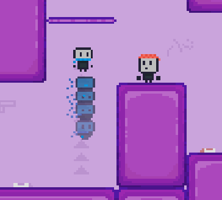

# RpurpleB

This game is a a simple puzzle platformer. It was made in a week for a game jam [Godocikowy Dżem #14](https://itch.io/jam/godocikowy-dzem-14).
The game was made by [Emil_Pok](https://github.com/EmilPok) and [Kelpekk](https://github.com/Kelpekk)

## 🏆 Winner of Godocikowy Dżem #14 (score: 4.762, the highest of any edition so far)

## 🎮 About the game

The players are in a laboratory-like area. Their objective is to work together and escape. One player can dash and the
other one can shoot. There are character-specific buttons that need to be pressed together at the same time to continue
the game. This game has 9 unique levels with progressing difficulty.

## 🕹️ Controls

| Action | Key |
|-------|---------|
| Movement  | W/A/S/D or Arrow Keys |
| Jump  | Space |
| Switch Characters | Alt or Ctrl |
| Restart | R |

## 📜 License

Project is available at **MIT** license, more in [LICENSE](LICENSE).
