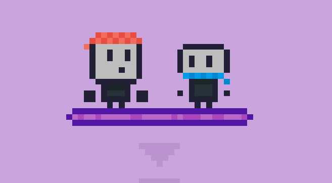

<div align="center">



# RpurpleB

**A puzzle platformer where you control two characters: one dashes, the other shoots, and neither can escape alone.**

[](https://emil-pok.itch.io/rpurpleb)
[](https://godotengine.org/download/)
[](LICENSE)

</div>

RpurpleB is a simple single-player puzzle platformer made in one week for the game jam [Godocikowy Dżem #14](https://itch.io/jam/godocikowy-dzem-14).

Made by [Emil_Pok](https://github.com/EmilPok) and [Kelpekk](https://github.com/Kelpekk).

> **Winner of Godocikowy Dżem #14** with a score of **4.762**, the highest of any edition so far.
> 
> [Result page](https://itch.io/jam/godocikowy-dzem-14/rate/4949958)

<div align="center">


</div>

## About the game

You find yourself in a laboratory-like area, and the only way out is to make two characters work together. You control both of them and switch between them at any time. One character can dash, the other can shoot. To finish a level, each character has to step on its own button at the same time.

The game has 9 unique levels with increasing difficulty.

## Controls

| Action            | Key                    |
|-------------------|------------------------|
| Move              | W/A/S/D or Arrow Keys  |
| Jump              | Space                  |
| Dash              | Shift                  |
| Shoot             | Left Click or Shift    |
| Aim               | Right Click or Shift   |
| Switch character  | Alt or Ctrl            |
| Restart level     | R                      |

## Getting started

### Play

Play in your browser or download the game on [itch.io](https://emil-pok.itch.io/rpurpleb).

### Run from source

1. Install [Godot 4.7](https://godotengine.org/download/).
2. Clone the repository:
   ```bash
   git clone https://github.com/EmilPok/RpurpleB.git
   ```
3. Open Godot, click **Import**, and select the `project.godot` file.
4. Press **F5** to run the game.

## License

The code in this project is licensed under the MIT License. See [LICENSE](LICENSE) for details.
